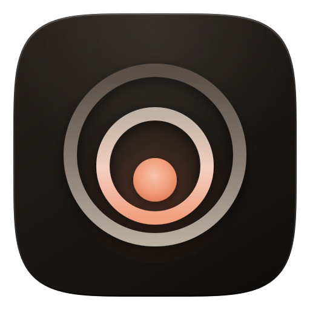
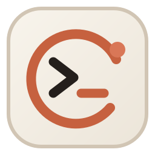
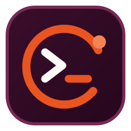

<div align="center">



# G-Gravity

**面向 Google Antigravity (`agy`) 的本地桌面智能编码工作台**

融合 Claude Code 与 Codex Desktop 的三栏工程交互 · 零额度本地离线思考汉化 · 100% 遵循官方公开协议

[**⬇️ 下载 Windows 便携版**](https://github.com/Mikotou/G-Gravity/releases) · [快速上手](#quick-start) · [界面一览](#layout) · [核心亮点](#features) · [快捷键速查](#shortcuts) · [账号安全](#security)

</div>

---

## 👋 它是什么？

如果你正在使用官方 `agy` 命令行工具写代码，但希望拥有**更直观的可视化界面、清晰的代码改动对比（Diff）以及顺手的中文阅读体验**，**Gravity**（源码仓库名 `G-Gravity`）就是为你准备的桌面客户端：

- **即插即用**：直接连接本机已安装的官方原版 `agy` CLI，无需配置第三方中转或代理。
- **清爽好读**：模型的英文思考过程自动翻译为中文（支持「中文 / 原文」一键切换），繁杂的文件读写与终端命令自动收纳进每回合的「操作记录」。
- **安心合规**：底层 100% 仅通过官方公开的 `agy acp` 标准协议通信，**不读取任何私有账号凭据、不修改官方目录、不自动轮换切号**。

> 📌 **说明**：本仓库为桌面端独立源码项目 `G-Gravity`，打包后的应用程序、窗口标题与任务栏名称均为 **Gravity**，用户配置与本地会话默认保存在 `%APPDATA%\Gravity`。

---

<a id="layout"></a>

## 🖥️ 界面布局一览

Gravity 采用 **Claude Code Studio 桌面工作台**架构：**48px 常驻极窄活动栏 + 可展开/调宽的会话抽屉 + 居中对话主舞台（单/双栏）+ 可停靠/悬浮切换的右侧检视器**。**抽屉宽度、检视器宽度、双栏比例与输入框高度均支持拖拽调整**（双击分隔条复位），高分辨率屏幕可用 `Ctrl + =` / `Ctrl + -` 整体缩放：

| 🧭 活动栏 + 📁 会话抽屉 (`Ctrl+B`) | 💬 中栏 · 对话主舞台 (`Ctrl+\`) | 🔍 右栏 · 停靠/悬浮检视器 (`Ctrl+J`) |
| :--- | :--- | :--- |
| • 48px 极窄常驻活动栏：一键新建、抽屉开关、项目/插件、账号与设置入口<br>• 会话抽屉按项目文件夹分组、搜索快速清空、置顶与一键整理标题（`分类｜事项`）<br>• **纯只读**导入官方历史对话并一键续聊 | • 支持 **单栏 / 左右双栏**（最多 4 路并发），从抽屉或标签拖入窗格即可换入会话，原会话保留在标签中继续运行<br>• 思考区支持 **「中文 / 原文」** 实时离线对照<br>• 读写与命令自动归入每轮 **「操作记录」**（折叠态带语义色微点）<br>• 已发消息悬停点 `✏️` **编辑并新建分支重发**<br>• 划词引用和批注以摘录、评论显示，可打包发送<br>• 悬浮岛式底部输入卡片，审批卡片采用 `1`–`4` 触感键帽，右下显示 **Gemini 周额度** | • 支持 **停靠 / 悬浮（Docked / Floating）** 一键切换与自由拖宽<br>• **Changes**：红绿行级 Diff 与变更文件清单二级视图<br>• **Plan**：任务拆解与 Todo 进度<br>• **Terminal**：命令输出（查看后自动清除未读标记）<br>• **Context**：上下文构成、Token 热力图与参考费用<br>• **Swarm**：多智能体协作拓扑看板 |

**⌨️ 底部多功能输入框（Composer）**：上方常驻显示当前上下文窗口占用率、`tok/s` 生成速率与一键 `/compact` 压缩入口；输入框内支持 `/` 快捷指令、`@` 搜索引用项目文件或会话、直接粘贴截图 / 拖拽附件，以及快速切换模型、推理强度与执行模式。

---

<a id="quick-start"></a>

## 🚀 3 步快速上手

### 方式一：直接下载使用（推荐普通用户）

无需安装 Node.js 或编译源码，开箱即用：

1. **确认官方 CLI 可用**：确保电脑已安装官方 `agy` 工具并完成登录（在终端运行 `agy --version` 能正常输出版本号即可）。
2. **下载便携版程序**：前往 [**GitHub Releases 发布页**](https://github.com/Mikotou/G-Gravity/releases) 下载单文件便携版 **`Gravity.exe`**，双击即可直接启动。
3. **新建对话开始编码**：按下 `Ctrl + N`，选择你的代码文件夹，即可开始对话！

<details>
<summary>💡 <b>提示找不到 <code>agy</code> 命令？点击查看指定路径启动方法</b></summary>

如果你的 `agy.exe` 没有加入系统环境变量 `PATH`（例如安装在 `D:\agy cli\agy.exe`），可以在 PowerShell 中指定路径后启动客户端：

```powershell
$env:AGY_BINARY_PATH = "D:\agy cli\agy.exe"
.\Gravity.exe
```

</details>

### 方式二：从源码运行与打包（适合开发者）

详见文末 [**🛠️ 开发者指南**](#dev-guide)。

---

<a id="features"></a>

## ✨ 核心亮点

### 1. 🧠 零额度本地离线思考汉化
- **本机离线实时翻译**：内置随包分发的 Mozilla (Bergamot) 英译简中模型，模型的英文推理（`Thinking`）在本地流式分段翻译为中文，**无需联网、0 账号额度消耗**，并自动保护代码块、命令与文件路径不被误翻。
- **双轨对照与记忆折叠**：支持随时一键切换 **「中文 / 原文」**；思考块默认展开，手动收起一次后，当前与后续新增片段都会自动保持收起（后台仍继续完成翻译）。

### 2. 💬 清爽不刷屏的对话与改码体验
- **每轮「操作记录」自动聚合**：助手执行的文件读取、搜索、编辑与终端命令统一收纳在当轮操作记录中，长命令与长输出按需展开，告别满屏日志刷屏。
- **消息编辑与分支重发**：鼠标移到自己发过的消息上点击 **✏️ 铅笔图标**，即可修改内容并从该处拉出新分支重新发送，原对话记录依然完整保留可随时切回查看。
- **划词引用、逐处批注与多模态输入**：选中回复中的任意片段即可添加多条 **Quote 引用** 或定位到具体消息的 **Notation 逐处标记批注** 汇总提问；聊天中的本地图片支持点击放大查看原图（按 `Esc` 关闭）。

### 3. 🛡️ 内联权限审批（`Approve for me`）
- 当助手请求执行命令或修改敏感内容时，对话流内直接弹出审批卡片，按键盘数字 **`1` ~ `4`** 即可快速放行、记住安全命令前缀、交由自动代审或拒绝并补充要求。
- 内置本地 Shell 词法安全快筛（自动识别纯只读检索命令并拦截高危操作），也支持按需配置你自己的公开 API（Gemini / OpenAI 兼容接口 / 本地 Ollama）辅助复审（API Key 仅驻留内存，绝不落盘）。

### 4. 📊 账户额度查询、Token 热力图与多账号隔离
- **官方账户额度面板（`Quota`）**：输入框右下方常显 Gemini 每周剩余额度。将鼠标移到该数值或左下角的额度图标，可查看各模型的 5 小时、每周剩余量和重置时间。窗口在前台时自动更新，也支持手动刷新。
- **Token 热力图与参考费用**：提供 `24h`（按小时）、`7d`（天×小时矩阵）、`30d`（日历热力格）三档统计，并按 `输入 / 缓存命中 / 输出 / 思考` 四维单价表估算分模型参考费用（*注：按公开 API 价格估算，非实际账单，支持自定义单价*）。
- **多账号物理隔离 + 插件管理**：通过官方 `agy acp --app-data-dir` 参数为不同账号分配独立目录，支持在设置页手动切换 Profile、拉起官方可见终端登录，以及可视化管理官方 `Plugins / MCP / Skills`。

### 5. 🎨 6 套经典主题 + 6 款原创应用图标
内置 `Claude Code Dark`、`Claude Code Light`、`macOS Dark`、`macOS Light`、`Ubuntu`、`Solarized Dark` 6 套预设主题（支持跟随系统），开放全部 **23 个颜色变量实时取色** 与 JSON 主题导入/导出，并配有 6 款可实时切换的原创 **Gravity** 窗口与任务栏图标：

<div align="center">

| Claude Dark | Claude Light | macOS Dark | macOS Light | Ubuntu | Solarized |
| :---: | :---: | :---: | :---: | :---: | :---: |
|  |  |  |  |  |  |

</div>

---

<a id="shortcuts"></a>

## ⌨️ 快捷键与交互速查

| 快捷键 / 操作 | 功能说明 |
| :--- | :--- |
| `Ctrl + N` | 新建对话（选择项目目录与初始模式） |
| `Ctrl + B` | 展开 / 收起左侧「项目与会话列表」 |
| `Ctrl + \` | 循环切换工作区分屏模式（单栏 ↔ 左右双栏） |
| `Ctrl + J` | 展开 / 收起右侧「检视器面板」（Diff / Terminal / Cost / Swarm 等） |
| `Ctrl + ,` | 打开 / 关闭全屏设置中心（打开时也可按 `Esc` 关闭） |
| `Shift + Tab` | 循环切换当前会话执行模式（`default` / `accept-edits` / `plan` / `auto`） |
| `Ctrl + =` / `Ctrl + -` / `Ctrl + 0` | 放大 / 缩小 / 复原界面缩放（高分辨率屏幕适配，也可在「设置 → 通用」调整） |
| 生成中按 `Esc` | 中断当前回合（输入框内的草稿保持不变） |
| 拖动 / 双击分隔条 | 调整侧栏、检视器宽度与双栏比例 / 恢复默认（聚焦后也可用方向键微调） |
| 数字键 `1` ~ `4` | 权限审批卡片快捷操作（`1` 允许 · `2` 记住安全前缀 · `3` 自动代审 · `4` 拒绝并说明） |
| 输入框内输入 `/` | 呼出快捷斜杠命令菜单（如 `/compact` 压缩上下文等） |
| 输入框内输入 `@` | 搜索并引用当前工作区文件或其他会话 |

---

<a id="security"></a>

## 🛡️ 账号安全与合规设计

Gravity 在架构层面严格遵守 **Google 服务条款（ToS）**，通过自动化回归测试守卫以下安全边界：

1. **100% 官方标准协议**：仅通过未修改的原版 `agy.exe acp`（JSON-RPC 2.0 over `stdio`）通信，不调用任何非公开内部接口，不篡改官方二进制程序。
2. **零触碰私有凭据**：严禁读取、复制或解析任何 OAuth Token、Cookie、密钥文件或内部状态库。
3. **本地历史纯只读**：导入本地 Antigravity 历史对话保持 **0 字节写入**；在客户端内点击「继续对话」会建立全新的标准 ACP 会话，绝不反向改写原文件。
4. **严禁自动切号轮换**：多账号 Profile 仅支持用户手动切换与官方可见终端 `--login` 登录；遇到 `429 / 403` 限流时自动进入退避冷却，绝不后台轮询多账号绕过配额。

更详细的技术合规边界请参阅：[`CLAUDE.md`](./CLAUDE.md) 与 [`docs/compliance/audit-report.md`](./docs/compliance/audit-report.md)。

---

<a id="dev-guide"></a>

## 🛠️ 开发者指南

### 环境要求
- **操作系统**：Windows 10 / 11 (x64)
- **Node.js**：`>= 22`（使用内置 `node:sqlite` 只读解析历史摘要副本）
- **官方 `agy` CLI**：已安装并加入系统 `PATH`（或通过环境变量 `AGY_BINARY_PATH` 指定 `agy.exe` 绝对路径）

### 源码安装、构建与打包

```bash
# 1. 安装依赖
npm ci

# 2. 全量 TypeScript 类型检查（shared + main + renderer + tests）
npm run typecheck

# 3. 运行自动化测试套件（Vitest，含安全合规边界与 UI 集成测试）
npm test

# 4. 构建生产产物（dist/main + dist/renderer）
npm run build

# 5. 构建并启动桌面客户端
npm start

# 6. 打包 Windows 可执行文件（输出 release/Gravity.exe 便携版与 release/win-unpacked/ 免解压目录版）
npm run dist:exe

# 7. 运行界面布局与 Windows 发行版桌面冒烟测试
npm run test:layout
npm run test:desktop
```

- **版本验收与文件校验记录**：详见 [`tests/QA-G-Gravity.md`](./tests/QA-G-Gravity.md)（包含桌面实测记录与发行包 SHA-256 校验值）。
- **架构与前后端契约说明**：详见 [`docs/architecture.md`](./docs/architecture.md)。

### 项目目录结构

- `assets/` & `public/` —— 6 套原创应用图标（SVG / PNG / ICO）、随包内置的本地离线翻译引擎资源与官方额度读取辅助脚本
- `src/shared/` —— 主进程与前端共享的 TypeScript 协议类型契约与纯安全校验函数
- `src/main/` —— Electron 35 主进程后端（ACP 通信、多会话复用、账号隔离与额度读取、安全审批、本地离线翻译、用量统计）
- `src/renderer/` —— React 19 + Vite 6 前端三栏工作台界面、自研安全 Markdown 渲染器与主题系统
- `docs/` & `tests/` —— 架构文档、Google ToS 合规审计报告与 Vitest 自动化测试套件

<details>
<summary>📂 <b>点击展开完整源码文件索引</b></summary>

```text
G-Gravity/
├── CLAUDE.md                        # 工程架构规范与十大合规红线必读指南
├── README.md                        # 项目介绍、快速上手与开发指南（本文件）
├── docs/
│   ├── architecture.md              # 客户端架构总纲与模块职责说明
│   └── compliance/
│       └── audit-report.md          # Google ToS 与账号安全十大合规红线逐项审计报告
├── assets/
│   ├── icons/                       # Electron 主进程窗口图标资产（6 套原创配色 × svg/png/ico）
│   ├── local-translation/           # 随包分发的 Mozilla (Bergamot) 英译简中离线翻译模型与许可证
│   └── quota/                       # 官方账户额度只读查询辅助资产
├── public/icons/                    # Renderer 静态图标资产（6 套原创配色 × svg/png/ico）
├── src/
│   ├── shared/                      # 主进程与渲染进程共享类型契约与安全校验函数
│   │   ├── acp-protocol.ts          # ACP JSON-RPC 协议类型与命令行参数黑白名单
│   │   ├── accounts-history-contract.ts # Profile、账户额度契约、凭据硬黑名单与只读历史白名单
│   │   ├── approval-contract.ts     # Approve for me 审批模式与风险等级契约
│   │   ├── ipc-channels.ts          # 全量 IPC 通道定义与请求/响应载荷类型
│   │   ├── message-revision.ts      # 消息编辑与分支重发契约
│   │   ├── plugins-contract.ts      # Plugins / MCP / Skills 类型与参数安全校验
│   │   ├── session-contract.ts      # 会话状态、并发上限（≤4）与分屏布局状态契约
│   │   ├── swarm-contract.ts        # Swarm 子智能体拓扑与消息流契约
│   │   ├── telemetry-contract.ts    # 24h/7d/30d 热力图与四维模型单价契约
│   │   ├── theme-i18n-contract.ts   # 6 套预设主题、23 色 Token 与防注入颜色校验器
│   │   └── index.ts                 # 统一导出入口
│   ├── main/                        # Electron 主进程后端
│   │   ├── index.ts                 # BrowserWindow 安全沙箱启动、单实例锁与可见终端登录拉起
│   │   ├── preload.ts               # 最小冻结桥接 window.gravityDesktop
│   │   ├── ipc-router.ts            # 主窗口 + mainFrame 来源校验、参数限流与 IPC 路由绑定
│   │   ├── core-service.ts          # 后端业务编排核心
│   │   ├── acp/acp-client.ts        # 官方 agy acp 子进程 stdio JSON-RPC 2.0 客户端与 429/403 熔断
│   │   ├── session/                 # SessionMultiplexer、InspectorStore 与消息图片加载
│   │   ├── accounts/                # AccountManager（手动隔离 Profile）与官方额度读取
│   │   ├── history/                 # HistoryImporter（本地历史纯只读零写入导入）
│   │   ├── approval/                # ApprovalEngine、Shell 词法快筛与可选外部公开 API 复审
│   │   ├── plugins/                 # PluginsManager（官方 agy plugin / mcp CLI 封装与 SKILL.md 只读扫描）
│   │   ├── telemetry/               # TelemetryStore（Token 速率、三档热力图与分模型费用计算）
│   │   ├── translation/             # 思考流智能分段与本地 Mozilla 离线翻译引擎封装
│   │   ├── organizer/               # TitleOrganizer（本地会话分类标题整理）
│   │   ├── swarm/                   # SwarmTracker（被动解析工具流构建多智能体看板）
│   │   ├── workspace/               # WorkspaceFiles（工作区文件树只读检索，供 @ 补全使用）
│   │   └── storage/                 # ClientStore（客户端独立 userData JSON 持久化）
│   └── renderer/                    # React 19 前端渲染层
│       ├── App.tsx                  # 全局状态编排、快捷键绑定与三栏工作台骨架
│       ├── styles/                  # global.css + design-system.css 与主题引擎
│       ├── i18n/                    # 中英双语词典
│       ├── lib/                     # 回合洞察统计与划词批注草稿纯函数
│       ├── services/                # desktop-bridge.ts（前端 IPC 调用与浏览器预览 Mock 回退）
│       └── components/              # 工作台核心 UI 组件、账户额度视图与全屏设置中心（SettingsView）
└── tests/                           # Vitest 自动化回归测试、桌面布局测试及 Windows 发行版验收报告
```

</details>
