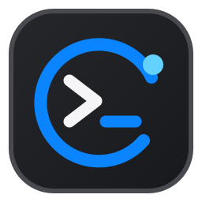
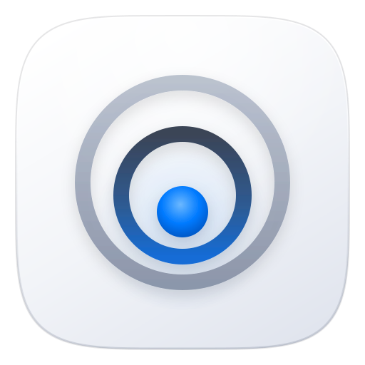
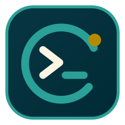

<div align="center">


# G-Gravity

**面向 Google Antigravity (`agy`) 的本地桌面智能编码工作台（Windows & macOS）**

100% 基于官方公开 `agy acp` 协议 · 零反代 · 零凭据触碰 · 零账号轮换

[**⬇️ 下载最新版（Windows / macOS）**](https://github.com/Mikotou/G-Gravity/releases) · [快速上手](#快速上手) · [合规底线](#合规与安全底线) · [开发构建](#源码构建)

</div>

---

## 核心特性

- **一体化三栏工作台**：极窄活动栏 + 项目会话抽屉 + 单/双分屏主舞台（最多 4 路并发）+ 可停靠/悬浮 5 页签检视器（`Changes` / `Plan` / `Terminal` / `Context`（含分支树二级视图）/ `Swarm`），支持新建会话弹窗与欢迎页直接选模型。
- **全栈性能优化与防封号深度加固（v0.3.4）**：`src/main`（98 文件）与 `src/shared` 全量 0 循环依赖；Swarm SQLite 迁入独立 Worker 线程（锁竞争下主线程 P99 < 16ms）、流式 50ms 合批（IPC 传输降 89.71%）、Windows/macOS 进程树 0 孤儿回收、第三方 API Key 零明文投影（`D4`）、更新包 SHA-256 校验与安全回滚；三层旧 CSS 收敛为单入口模块化体系（301.7 KB → 221.0 KB 源码 / 202.88 KB 产物 / 36.02 KB gzip，0 死类、0 跨文件重复选择器），6 套预设与自定义主题达成 100% WCAG 2.1 AA 对比度。
- **AI 优先 `Approve for me` 安全代审 & 合规 `Turbo` 模式**：`AI 代审` 模式下除防封号/账号安全红线外由外部 AI 独立裁决（符合意图的高风险及以下自动放行，偏离意图的中风险及以上转人工）；无 AI「仅规则」模式支持合理开发/构建/只读命令链快筛；内置合规 `Turbo (full-access)` 模式与二次风险确认。
- **编辑级排版、macOS 原生字体与图文分区**：精雕 macOS `SF Pro` + `PingFang SC` 中英混排与 6 套 Apple HIG `1024×1024` Dock 图标（默认「跟随主题（自动）」联动）；全站矢量 `ui/Icon` 四档图标与可靠的剪贴板复制；行内干净文件芯片、独立成段 `<figure>` 预览，文末严格分离**视觉媒体画廊**与**文件目录托盘**。
- **结构化暂停诊断与失败防静默恢复**：覆盖 `max_tokens`、手动中断、命令失败/拦截后防静默卡死、`429/403` 熔断倒计时、`401` 失效、上下文超限与 ACP 断连等 14 类场景，自动去重合并重复诊断卡并提供一键合规恢复。
- **零额度离线思考汉化**：随包内置 Mozilla Bergamot 英译简中模型，零联网消耗，支持中/原文切换与可选外部翻译 API。
- **Context & Cost 实时看板**：实时 `tok/s`、缓存命中率、压缩记录、重设计后的 `24h` 柱图 / `7d` 星期×小时热力矩阵 / `30d` Mon–Sun 日历热力格与 3 枚 KPI 卡片，覆盖主 Context / 外部复核 / 外部翻译三视图及参考费用估算（非官方账单）。
- **6 套 WCAG AA 主题 & 全新 C4 图标**：支持深/浅色跟随、23 色自定义导入导出及内置 GitHub Releases 自动更新。

<div align="center">

| Claude Dark | Claude Light | macOS Dark | macOS Light | Ubuntu | Solarized |
| :---: | :---: | :---: | :---: | :---: | :---: |
|  |  |  |  |  |  |

</div>

---

## 快速上手

1. **确认官方 CLI 可用**：终端执行 `agy --version` 正常输出并已完成官方登录。
2. **下载对应平台安装包**：前往 [**GitHub Releases**](https://github.com/Mikotou/G-Gravity/releases) 下载：
   - **Windows (x64)**：`Gravity.exe`（单文件便携版，双击即用）
   - **macOS (Apple Silicon)**：`Gravity-<version>-mac-arm64.dmg`（或 `.zip`）
   - **macOS (Intel)**：`Gravity-<version>-mac-x64.dmg`（或 `.zip`）
3. **开始编码**：启动后按 `Ctrl + N`（macOS 为 `⌘ + N`）选择项目目录即可。

<details>
<summary>首次启动未签名提示 & 自定义 <code>agy</code> 路径</summary>

- **Windows SmartScreen**：点击「更多信息」→「仍要运行」。
- **macOS Gatekeeper**：拖入「应用程序」后在终端执行一次 `xattr -cr /Applications/Gravity.app`。
- **手动指定 `agy` 路径**：
  - Windows PowerShell：`$env:AGY_BINARY_PATH = "C:\path\to\agy.exe"; .\Gravity.exe`
  - macOS：`AGY_BINARY_PATH="/path/to/agy" /Applications/Gravity.app/Contents/MacOS/Gravity`

</details>

---

## 合规与安全底线

Gravity 是官方原版 `agy` CLI 的**本地可视化外壳**（非反代、非号池），所有红线由自动化测试持续守卫（详见 [`CLAUDE.md`](./CLAUDE.md) 与 [`docs/compliance/audit-report.md`](./docs/compliance/audit-report.md)）：

- **纯官方协议**：仅通过本机未修改的 `agy acp`（JSON-RPC over `stdio`）与公开 `agy plugin / mcp / --login` 子命令通信，零私有接口。
- **零凭据触碰与零写入**：严禁读写 OAuth Token、Cookie、`state.vscdb`、`*.pb` / `*.pbtxt`、Keychain 等敏感路径；客户端数据独立存于系统应用数据目录，对 `~/.gemini` 保持零写入。
- **并发与熔断保护**：硬上限最多 **4 路并行活跃会话**；遇 `429` 自动冷却 ≥ 60s、`403` 自动冷却 ≥ 300s；多账号仅基于 `--app-data-dir` 物理隔离并 **100% 人工手动切换**，严禁自动轮号。
- **强沙箱隔离**：Electron 启用 `contextIsolation`、`sandbox`、`webSecurity`，关闭 `nodeIntegration`，所有外部命令执行均强制 `shell: false`。

---

## 常用快捷键

> macOS 请将 `Ctrl` 替换为 `⌘`。

| 快捷键 | 功能 |
| :--- | :--- |
| `Ctrl + N` / `Ctrl + ,` | 新建对话 / 打开设置 |
| `Ctrl + B` / `Ctrl + \` / `Ctrl + J` | 切换左侧抽屉 / 单双分屏 / 右侧检视器 |
| `Shift + Tab` | 在安全权限模式间循环切换（`default` / `accept-edits` / `plan`，不误入 `Turbo`） |
| `Ctrl + =` / `-` / `0` | 调整 / 重置界面缩放 |
| `1` ~ `4` | 权限审批快捷决策（允许 / 记住前缀 / 自动代审 / 拒绝并说明） |
| `Esc` / 空框 `↑` | 中断当前生成 / 编辑上一条消息并新建分支重发 |

---

## 源码构建

需要 **Node.js ≥ 22** 与已登录的官方 `agy` CLI：

```bash
npm ci
npm run typecheck && npm test   # 类型检查 + 全量单测与合规守卫
npm start                       # 构建并本地启动
npm run dist:exe                # 打包 Windows 便携版 (release/Gravity.exe)
npm run dist:mac                # 打包 macOS dmg/zip（需在 macOS 运行）
```

## License

遵循仓库开源许可协议，详情见 [`CLAUDE.md`](./CLAUDE.md) 与 [`assets/local-translation/NOTICE.md`](./assets/local-translation/NOTICE.md)。
